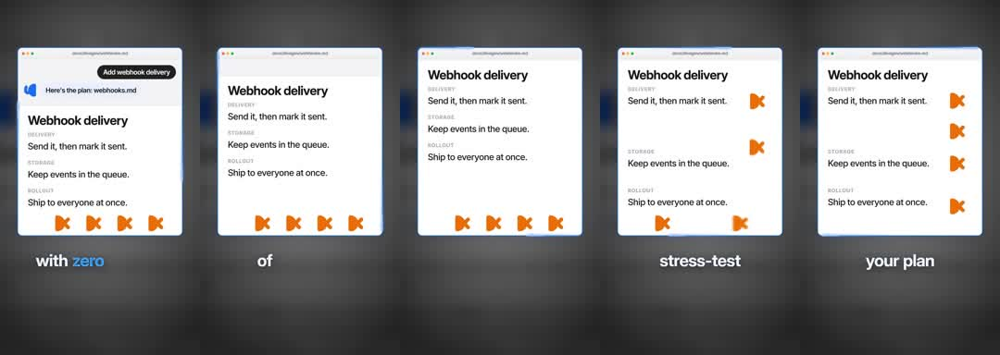

# v19_s12 · window_zoom · 19.3–22.0s (calidad 5)

- **Guion:** zero context of that chat stress test your plan,
- **Qué se ve:** Los peces vuelan desde la fila inferior a la derecha de cada sección del plan (uno por sección).
- **Diseño:** Iconos naranjas alineados a la derecha (x≈85 %).
- **Efectos:** Motion blur en los iconos.
- **Animación:** [observed 20.8–21.47] cada pez sube con blur a su línea (≈2 fr cada uno, escalonados).
- **Por qué aquí:** [inferred] 'stress test' = revisores asignados a cada parte.
