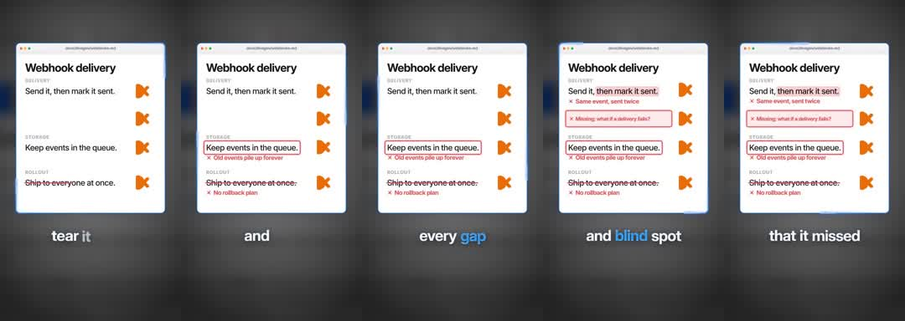

# v19_s13 · window_zoom · 22.2–25.0s (calidad 5)

- **Guion:** tear it apart and find every gap and blind spot that it missed.
- **Qué se ve:** Anotaciones rojas: 'Keep events in the queue.' enmarcado en rojo, 'Ship to everyone at once.' tachado, notas '× Old events pile up forever', '× No rollback plan', '× Same event, sent twice' y un hueco nuevo 'Missing: what if a delivery fails?' en caja roja.
- **Diseño:** Rojo #E0342F; notas sans pequeñas rojas bajo cada línea. 'blind' azul.
- **Efectos:** —
- **Animación:** [observed 22.5] tachado + nota; [observed 23.0] caja; [observed 23.5–24.0] caja vacía de 'Missing' se dibuja y se rellena.
- **Por qué aquí:** [inferred] 'tear apart / gaps' literal: el plan queda lleno de correcciones.
