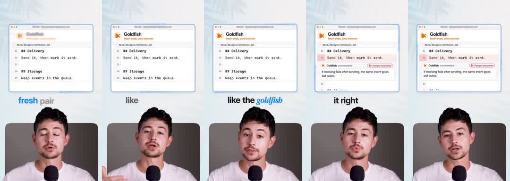

# v19_s15 · window_zoom · 28.7–31.6s (calidad 5)

- **Guion:** but a fresh pair of eyes like the goldfish will catch it right away.
- **Qué se ve:** La cabecera cambia a 'Goldfish · fresh eyes, zero context'; una línea se marca en rojo y aparece comentario 'Goldfish commented · Changes requested: If marking fails after sending, the same event goes out twice.'
- **Diseño:** Fondo rojo claro en la línea; píldora 'Changes requested' roja. 'fresh' azul, 'goldfish' serif itálica.
- **Efectos:** —
- **Animación:** [observed 28.45–28.8] crossfade de cabecera Elephant→Goldfish; [observed 30.5] comentario aparece.
- **Por qué aquí:** [inferred] Contraste directo con s14: el pez sí ve el fallo.
