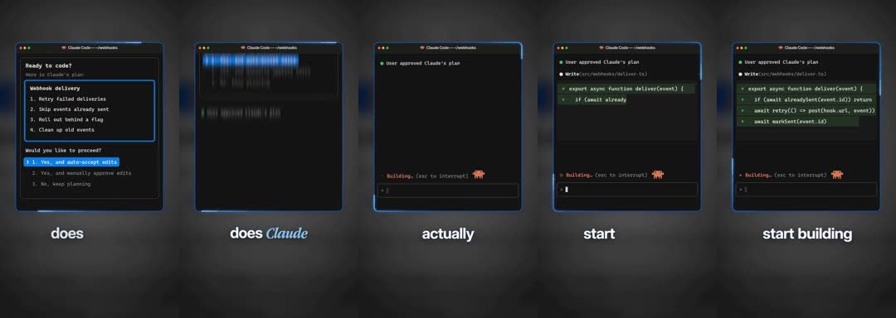

# v19_s17 · window_zoom · 33.5–34.5s (calidad 4)

- **Guion:** does Claude actually start building,
- **Qué se ve:** Whip-scroll con blur y la terminal muestra 'User approved Claude's plan · Write(src/webhooks/deliver.ts)' y diff verde '+ export async function deliver…' con 'Building…'.
- **Diseño:** 'Claude' serif itálica azul.
- **Efectos:** Motion blur vertical.
- **Animación:** [observed 33.67–33.93] whip-scroll vertical (≈4 fr).
- **Por qué aquí:** [inferred] Ahora sí construye.
