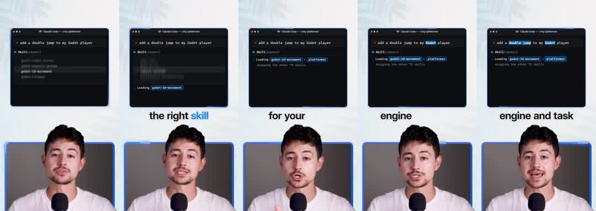

# v20_s08 · window_zoom · 15.8–18.0s (calidad 4)

- **Guion:** the right skill for your own engine and task
- **Qué se ve:** Lista de skills con 'godot-2d-movement' seleccionado (fondo azul + ✓), 'Loading godot-2d-movement · platformer, skipping the other 75 skills'; en 'engine and task' se resaltan 'double jump' y 'Godot' en el prompt.
- **Diseño:** 'skill' azul.
- **Efectos:** —
- **Animación:** [observed 16.0] selección; [observed 17.5] resaltados en el prompt.
- **Por qué aquí:** [inferred] Literal: elige la skill correcta.
